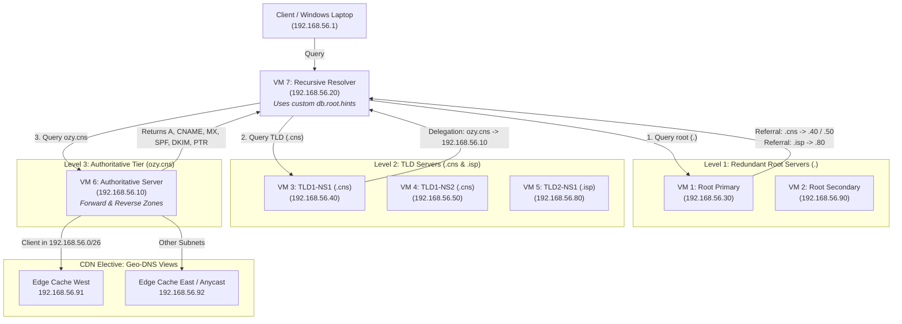

# PBL DNS & CDN Infrastructure: 7-VM Hierarchical DNS Tree & CDN Geo-DNS

[](https://www.debian.org/)
[](https://www.isc.org/bind/)
[]()
[]()

> **Student / Technical Lead:** Okwudili Ujubuonu (Dili)  
> **Course:** Computer Networks & Internetworking (CNS3204)  
> **Project Scope:** Complete 7-VM Distributed DNS Tree + Distributed Email + ISP Network + CDN Elective

---

## ⚡ TL;DR (Executive Summary)

This project implements a full, RFC-compliant **hierarchical DNS Tree deployed across 7 dedicated Debian Virtual Machines** using **BIND 9** on subnet `192.168.56.0/24`:

1. **Level 1 (Redundant Root Servers `.`):**
   - **Primary Root (VM 1: `192.168.56.30`):** File Server node acting as Root.
   - **Secondary Root (VM 2: `192.168.56.90`):** HAProxy node acting as redundant Root.
   - Holds delegations and glue A records for `.cns` and `.isp`.
2. **Level 2 (Two Top-Level Domains):**
   - **TLD 1 (`.cns`):** Has **TWO Name Servers** (`ns1.cns` at `192.168.56.40` and `ns2.cns` at `192.168.56.50`). Delegates `ozy.cns` down to the authoritative tier. Points `/etc/resolv.conf` to `8.8.8.8` (no recursion to customer resolver).
   - **TLD 2 (`.isp`):** Hosted on `192.168.56.80`. Provides secondary top-level domain partitioning.
3. **Level 3 (Authoritative Server `ozy.cns` on VM 6: `192.168.56.10`):**
   - Forward zone with A, CNAME, dual MX (`10 mail` & `20 mail2`), SPF (`v=spf1`), DKIM (`v=DKIM1`), and reverse PTR records in `56.168.192.in-addr.arpa`.
4. **Level 4 (Recursive Caching Resolver on VM 7: `192.168.56.20`):**
   - Client-facing caching resolver with custom `db.root.hints` pointing to Root servers (`.30` & `.90`), enabling complete offline tree traversal. Supports live cache flushing via `rndc flush`.
5. **CDN Elective (Geo-DNS Steering):**
   - BIND 9 split-horizon views steering client queries dynamically to nearest edge cache nodes (`192.168.56.91` West vs `192.168.56.92` East).

---

## 📐 The 7-VM DNS Tree Topology



---

## 🗺️ Master 7-VM IP & Role Allocation Table

| VM # | Hostname / Role in Lab | IP Address | Dedicated DNS Role | Zone(s) Hosted |
| :--- | :--- | :--- | :--- | :--- |
| **VM 1** | `nfs.ozy.cns` (File Server) | `192.168.56.30` | **Level 1:** Primary Root Server (`.`) | `.` (delegates `.cns` & `.isp`) |
| **VM 2** | `www.ozy.cns` (HAProxy LB) | `192.168.56.90` | **Level 1:** Secondary Root Server (`.`) | `.` (redundant root) |
| **VM 3** | `ldap.ozy.cns` (LDAP Master) | `192.168.56.40` | **Level 2:** TLD 1 Primary Name Server | `cns` (delegates `ozy.cns`) |
| **VM 4** | `ldapslv.ozy.cns` (LDAP Slave) | `192.168.56.50` | **Level 2:** TLD 1 Secondary Name Server | `cns` (redundant TLD NS) |
| **VM 5** | `sqlslv2.ozy.cns` (MySQL Slave 2)| `192.168.56.80` | **Level 2:** TLD 2 Primary Name Server | `isp` (delegates `cdn.isp`) |
| **VM 6** | `ns1.ozy.cns` (DNS Server) | `192.168.56.10` | **Level 3:** Authoritative Server | `ozy.cns`, `db.192.168.56`, `cdn.west` |
| **VM 7** | `mail.ozy.cns` (Email Server) | `192.168.56.20` | **Resolver:** Recursive Resolver | Uses custom `db.root.hints` |

---

## 🔬 Live `tcpdump` Packet Trace Analysis (Tree Walk in Action)

When the Resolver cache is flushed and a query is issued for `www.ozy.cns`, `tcpdump -n -i any port 53` reveals the complete 4-hop iterative traversal:

```text
# 1. Windows Client (192.168.56.1) queries the Resolver (192.168.56.20)
11:11:28.489349 In  IP 192.168.56.1.57940 > 192.168.56.20.53: A? www.ozy.cns.

# 2. Resolver queries Level 1 Root (.90)
11:11:28.489970 Out IP 192.168.56.20.56418 > 192.168.56.90.53: NS? cns.
11:11:28.492746 In  IP 192.168.56.90.53 > 192.168.56.20.56418: Referral -> ns1.cns (192.168.56.40)

# 3. Resolver queries Level 2 TLD 1 (.40)
11:11:28.492995 Out IP 192.168.56.20.53645 > 192.168.56.40.53: NS? ozy.cns.
11:11:28.495336 In  IP 192.168.56.40.53 > 192.168.56.20.53645: Referral -> ns1.ozy.cns (192.168.56.10)

# 4. Resolver queries Level 3 Authoritative (.10)
11:11:28.495821 Out IP 192.168.56.20.35262 > 192.168.56.10.53: A? www.ozy.cns.
11:11:28.496858 In  IP 192.168.56.10.53 > 192.168.56.20.35262: Answer -> A 192.168.56.90

# 5. Resolver returns final authoritative answer back to Windows Client
11:11:28.497093 Out IP 192.168.56.20.53 > 192.168.56.1.57940: Answer -> A 192.168.56.90
```

### ⚡ Caching Behavior Proof
Subsequent queries (e.g. for `olt.ozy.cns` and `billing.ozy.cns`) bypass Root and TLD completely:
```text
In  IP 192.168.56.1  > 192.168.56.20: A? olt.ozy.cns.
Out IP 192.168.56.20 > 192.168.56.10: A? olt.ozy.cns.
In  IP 192.168.56.10 > 192.168.56.20: Answer -> A 192.168.56.48
Out IP 192.168.56.20 > 192.168.56.1 : Answer -> A 192.168.56.48
```
The resolver learned the authoritative nameserver for `ozy.cns` on the first query, caching it and going directly to `.10`, proving optimal caching performance!

---

## 🧪 Master Verification Commands Suite (`tcpdump`, `dig`, `nslookup`)

### 1. Flush Resolver & Client Caches (Before Live Demos):
```bash
# On Resolver VM (192.168.56.20):
sudo rndc flush

# On Windows Client:
ipconfig /flushdns
```

### 2. Live Packet Sniffing on Tree Nodes:
```bash
# Run on Resolver (.20), Root (.30), TLD (.40), or Authoritative (.10):
sudo tcpdump -n -i any port 53
```

### 3. Level 1 Root Servers Verification:
```bash
dig @192.168.56.30 cns. NS +norecurse
dig @192.168.56.30 isp. NS +norecurse
dig @192.168.56.90 cns. NS +norecurse
```

### 4. Level 2 TLD Servers Verification:
```bash
dig @192.168.56.40 ozy.cns. NS +norecurse
dig @192.168.56.50 ozy.cns. NS +norecurse
dig @192.168.56.80 cdn.isp. NS +norecurse
```

### 5. Level 3 Authoritative Records:
```bash
dig @192.168.56.10 www.ozy.cns +short           # 192.168.56.90 (HAProxy VIP)
dig @192.168.56.10 smtp.ozy.cns CNAME +short    # mail.ozy.cns.
dig @192.168.56.10 ozy.cns MX +short            # 10 mail, 20 mail2
dig @192.168.56.10 ozy.cns TXT +short           # "v=spf1 ..."
dig @192.168.56.10 default._domainkey.ozy.cns TXT +short
dig @192.168.56.10 -x 192.168.56.20 +short      # mail.ozy.cns. (PTR)
dig @192.168.56.10 ldap.ozy.cns +short          # 192.168.56.40
dig @192.168.56.10 billing.ozy.cns +short       # 192.168.56.45
dig @192.168.56.10 olt.ozy.cns +short           # 192.168.56.48
dig @192.168.56.10 wifi.ozy.cns +short          # 192.168.56.49
```

### 6. Client Recursive Resolution:
```powershell
nslookup www.ozy.cns 192.168.56.20
nslookup mail.ozy.cns 192.168.56.20
nslookup ldap.ozy.cns 192.168.56.20
```

### 7. Geo-DNS CDN Steering:
```bash
dig @192.168.56.10 edge.cdn.ozy.cns +short      # 192.168.56.91 (West View)
```
